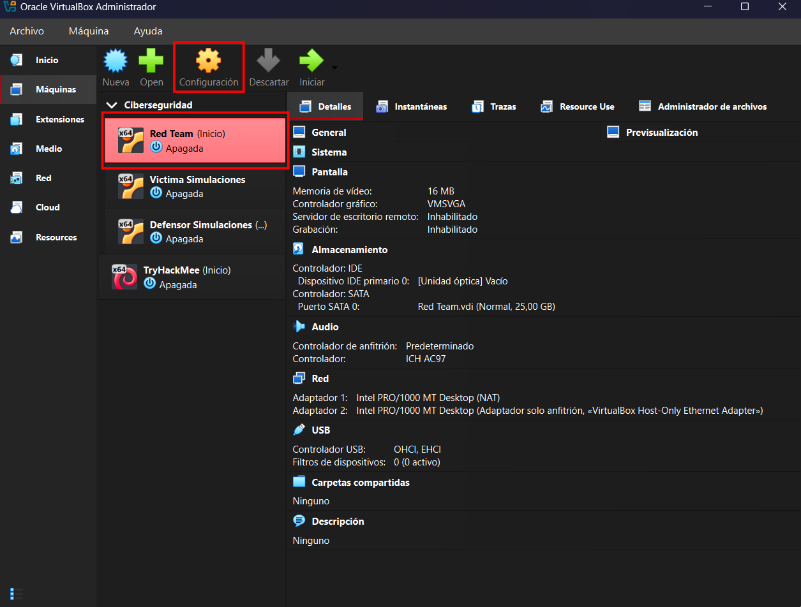
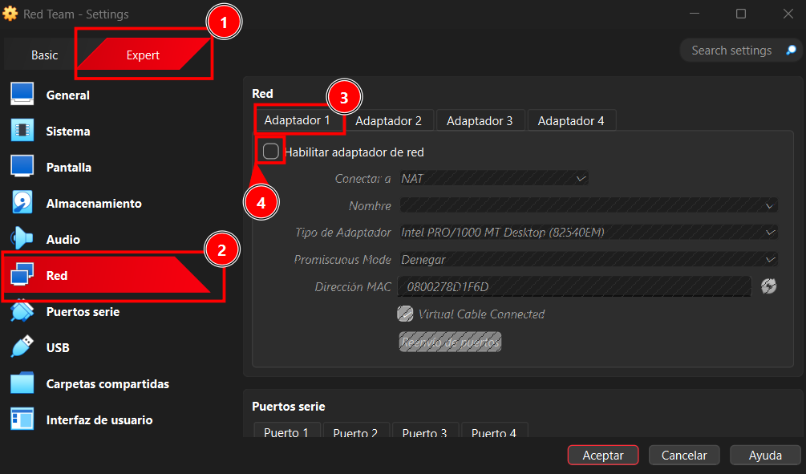
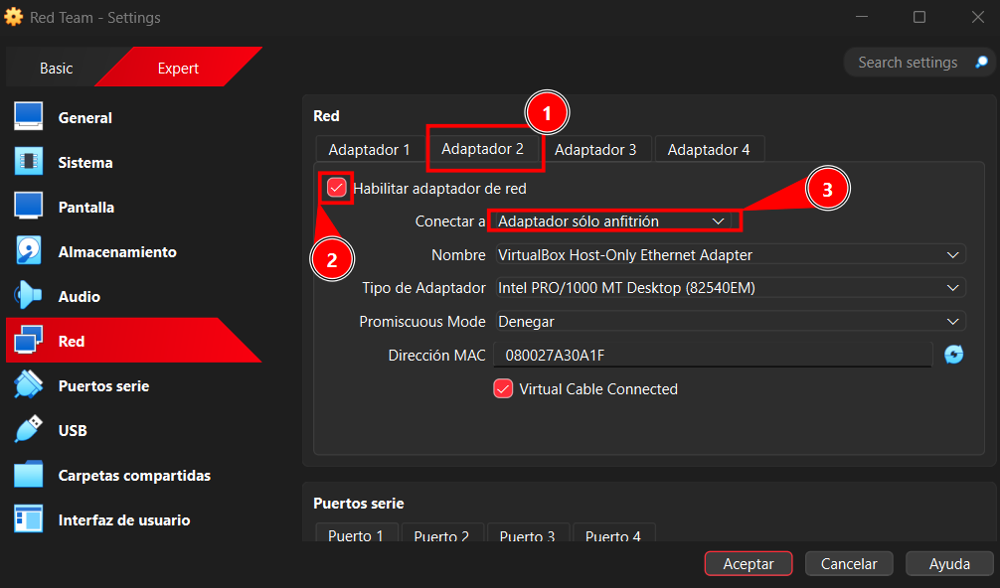
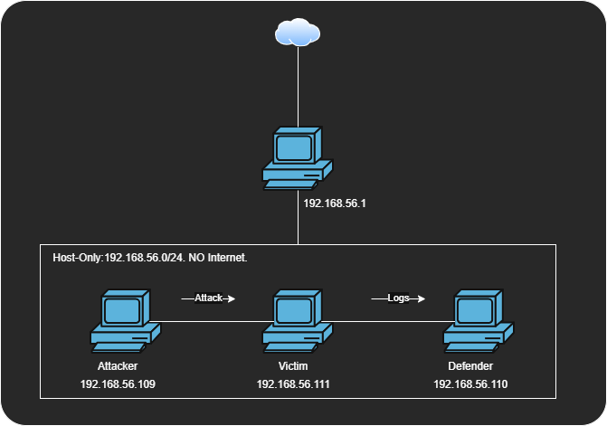

# Setup Virtual Machines

There are going to be **3 virtual machines**. The attacker will have a Kali Linux, the defensor will have a Linux Server and the victim will also have a Linux Server

Tha aplication to virtualize the previous machines is going to be **Oracle VirtualBox**.

The next links are the direct link to download the machines I am using:
- [Ubuntu Server](https://ubuntu.com/download/server/thank-you?version=26.04.1&architecture=amd64&lts=true)
- [Kali Linux](https://cdimage.kali.org/kali-2026.3/kali-linux-2026.3-installer-amd64.iso)

Configure all of your machines as you wish(ram, cores, memory, username, password, etc) and start the machines. The moment you get access to the terminal input the next series of commands:

 ```
sudo apt update && sudo apt upgrade -y
sudo apt install net-tools
sudo apt install openssh-server
 ```

For every package installed input the next command:
```
sudo systemctl start <package>
sudo systemctl enable <package>
```
Before doing this next section do the [Setup Defender](02-setup-defender.md) and [Setup Victim](03-setup-vitim.md) to install wazzuh before isolating the machines.

---

Shut down the 3 virtual machines and for each one go to configure on **Oracle VirtualBox**.



On the new display page go to expert mode, navigate to the network tab, disable the NAT network adapter and enable another network adpater as a "Host-Only".




## Network disposition

When finish the previous tasks, my machines will have the next distruibuition on the network.



As you can see, the three machines are completely isolated from internet and the only conexion they will have are throught my PC.

Beside that, they are fully connected each other. However, the attacker will only attack the Victim, the victim will just send logs to the Defender and the Defender will fix the vulnerability.