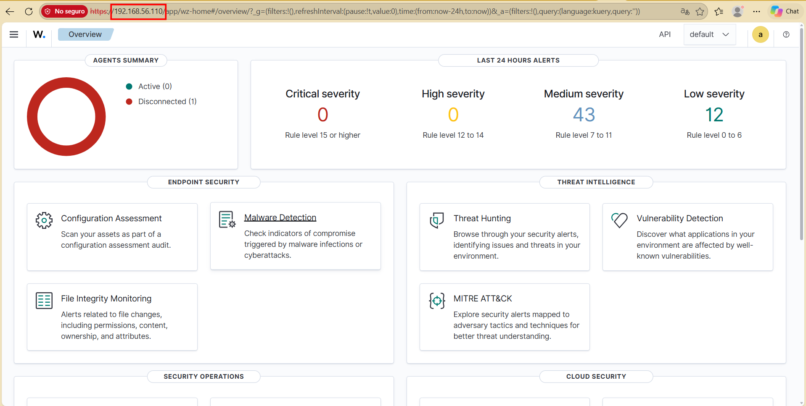

# Setup Defender

We are doing to install wazuh in the machine of the defender to analyze and visualize the data.

The defender is going to have the wazuh indexer,server and dashboard. In order to install this requirements follow the next steps

Enter the next code:

```
curl -sO https://packages.wazuh.com/4.14/wazuh-install.sh && sudo bash ./wazuh-install.sh -a
```

Once the installation is finished, it will grant the credentials to enter the dashboard.

To enter the dashboard open a search engine and search the next url and log in.
```
https://IP_DEFENDER
```

