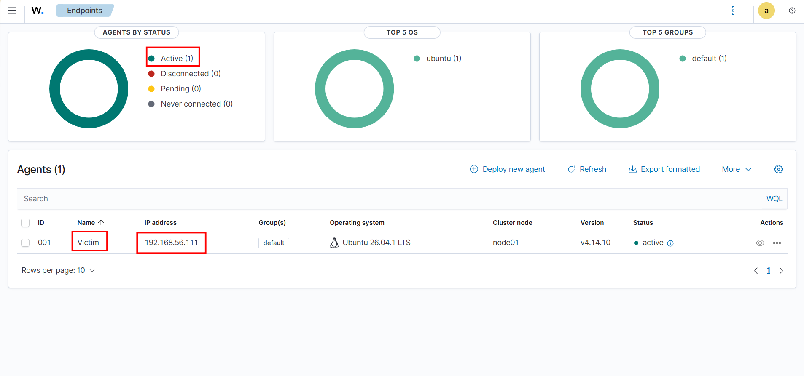

# Setup Victim

Now we need to set up the agent from wazuh to recolected the logs. 

In the page of wazuh supported by the defender go to "Home > Overview" and deploy a new agent.

Fill up the fields that the page need to and copy and paste the commnad it gives you on the machine Victim.

After the configuration, verify that you have an active machine in your dashboard

